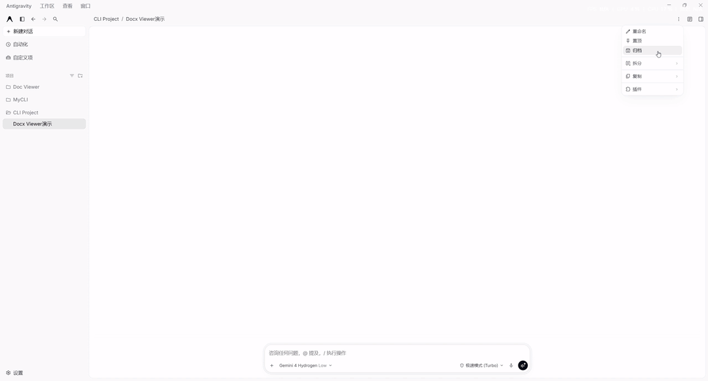
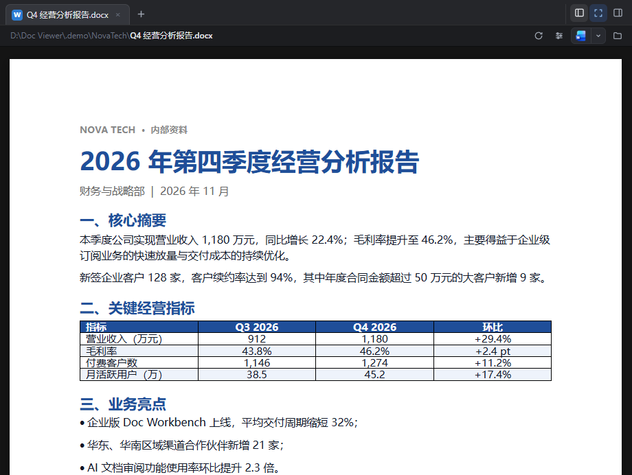
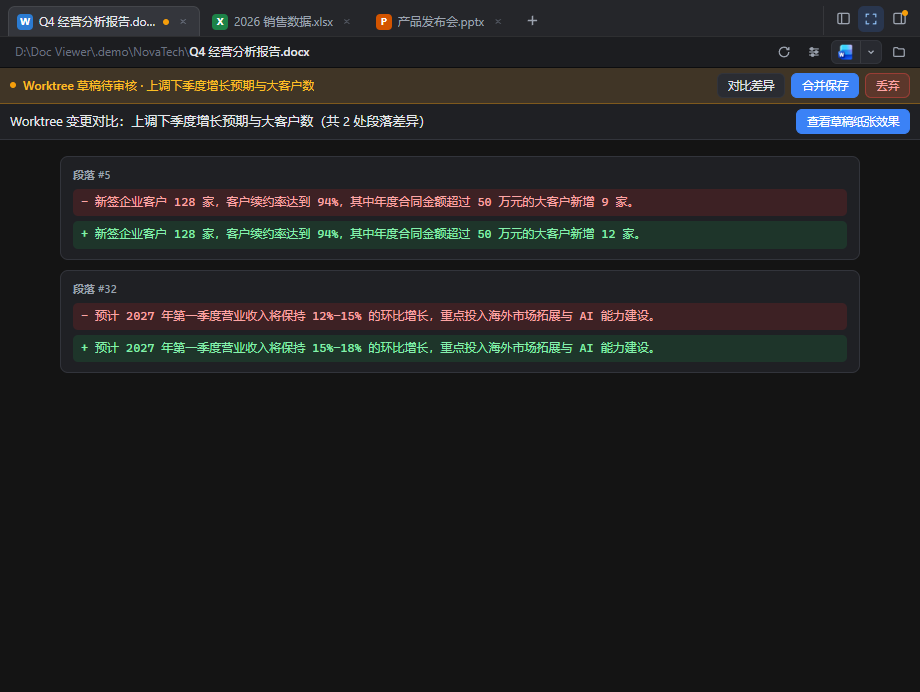
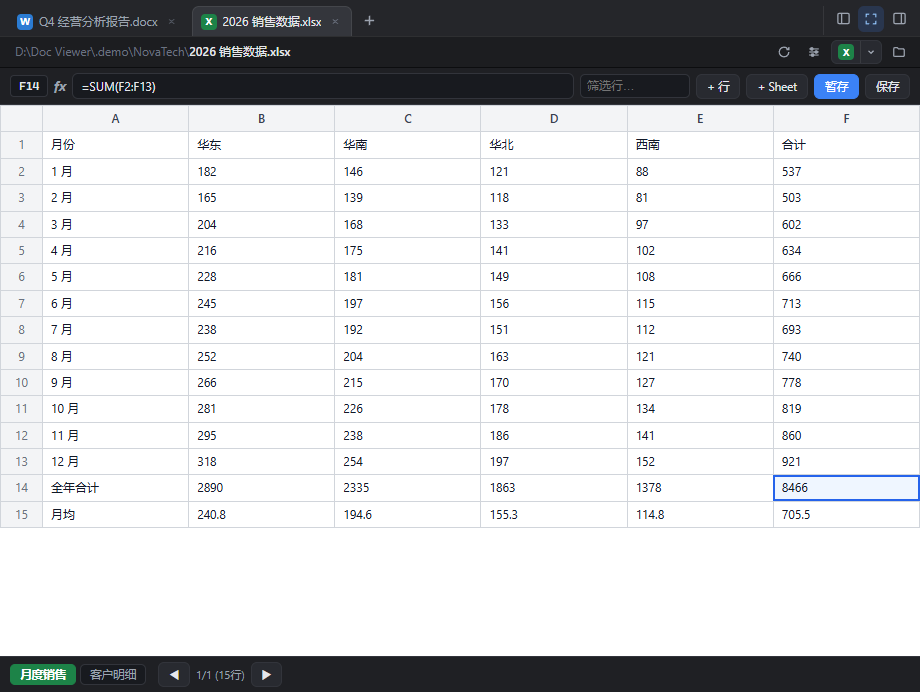
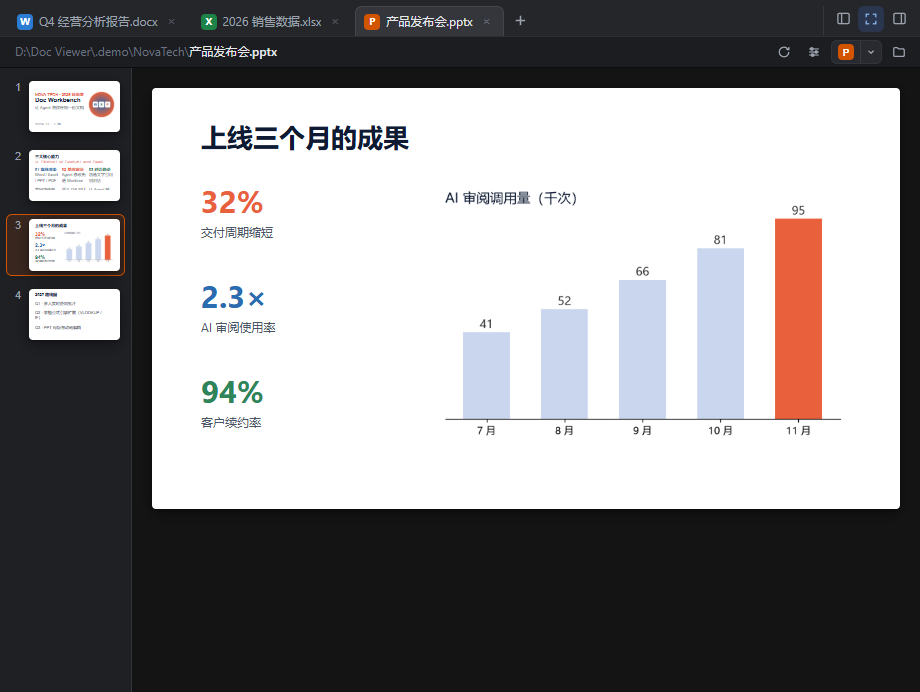

<div align="center">


# Antigravity Doc & Office Workbench (`doc-viewer`)

**完全离线、零运行时 `node_modules` 依赖的 Google Antigravity MCP App 办公工作台**  
在侧边栏（`aux_pane`）直接阅读、编辑、对比与审阅 Word / Excel / PPT / PDF / Markdown / HTML 与代码文件

[](https://github.com/Johnsonfreee/antigravity-doc-viewer)
[](#architecture)
[](package.json)
[](LICENSE)

[演示动画](#demo) · [核心特性](#features) · [界面预览](#previews) · [支持格式](#formats) · [Worktree 审阅流](#worktree) · [MCP 工具](#tools) · [快速安装](#install) · [离线架构](#architecture)

<br />

<a id="demo"></a>


</div>

---

<a id="features"></a>
## 核心特性

- **100% 离线运行与本地隐私**
  - 前端通过 `vite-plugin-singlefile` 打包为单文件 `dist/app.html`，服务端通过 `esbuild` 打包为单文件 `dist/server.cjs`，并内置完整 `pdfjs-dist` 中文 CJK CMaps 与标准字体。
  - 离线安装后无需 `node_modules` 即可运行，构建脚本自动校验输出不包含外部 HTTP/HTTPS `<script>` 或 `<link>` 引用，文档内容全程留在本地磁盘。
- **桌面级暗色办公壳与多通道打开方式**
  - 双层顶部栏：带 `W` / `X` / `P` / `PDF` 彩色徽标的多标签页 + 智能路径地址栏（支持 `@`、引号、Markdown 链接与 `file://` URI 自动解析）+ 系统默认程序与「打开方式」分裂按钮。
  - 悬停渐显的底部快捷胶囊控制栏（翻页、适应侧栏/百分比缩放、阅读/编辑/对比模式切换），搭配可折叠的左侧栏（文件树 / 目录大纲 / 收藏夹）与右侧栏（Worktree & 版本 / AI 审阅）。
  - 支持从对话中拖拽文档链接、从桌面拖入本地文件，以及聚焦面板后 `Ctrl+V` 粘贴路径打开。
- **Word / Excel / PPT 高保真渲染与在线编辑**
  - **Word (`.docx`)**：前端基于 `docx-preview` 还原字体、表格与嵌入图片并按 A4 高度自动分页；服务端直接操作 OOXML，支持跨 `<w:r>` Run 查找替换、段落/表格单元格修改与追加区块，不破坏原有版式。
  - **Excel / CSV (`.xlsx` 等)**：带 `fx` 公式栏、单元格双击内联编辑、`SUM` / `AVERAGE` / `COUNT` / `MIN` / `MAX` 常用公式计算、工作表切换与分页行筛选。
  - **PowerPoint (`.pptx`)**：左侧缩略图胶片条 + 16:9 幻灯片主画布，支持内嵌图片与表格渲染、单页编辑与新增幻灯片。
  - **旧版与 WPS 格式兼容**：内置 CFB/XML 解析管线，离线阅读 `.doc` / `.wps` / `.dot` / `.rtf` / `.odt` / `.ppt` / `.dps` / `.xls` / `.et`。
- **Worktree 草稿隔离与版本历史**
  - Agent 或用户在编辑器中的修改默认暂存至独立 Worktree 草稿区，顶部自动显示审阅横幅，支持语义级 Diff 对比（段落级 / 单元格级 / 幻灯片级）、一键 **合并保存** 或 **丢弃**，每次写入自动生成版本快照供随时回滚。
- **AI 对话深度联动**
  - 划选任意文档文本即可通过浮动工具条一键 **引用到对话**（`updateModelContext`）或 **让 Agent 解释**（`sendMessage`），也可在右侧「AI 审阅」面板一键触发总结与格式错别字检查。

---

<a id="previews"></a>
## 界面预览

| Word 仿真 A4 纸张阅读 | Worktree 草稿语义 Diff 审阅 |
| :---: | :---: |
|  |  |
| **Excel 交互式表格与 `fx` 公式栏** | **PowerPoint 缩略图胶片条与 16:9 画布** |
|  |  |

---

<a id="formats"></a>
## 全格式支持矩阵

| 文档类别 | 支持扩展名 | 阅读能力 | 编辑 / Worktree 支持 |
| --- | --- | --- | --- |
| **Word 文档** | `.docx` | `docx-preview` 还原排版 + A4 自动分页 + 大纲提取 | OOXML 跨 Run 替换、段落/表格编辑、追加区块、语义 Diff |
| **旧版 / WPS 文档** | `.doc` `.wps` `.dot` `.rtf` `.odt` | CFB 二进制 / RTF / ODF 离线解析 + 自动分页 + 大纲 | 只读预览（`docx` 别名文档自动委托 OOXML 引擎） |
| **Excel / 表格** | `.xlsx` `.xls` `.et` `.xlsm` `.xlsb` `.ods` `.csv` `.tsv` | `SheetJS` 多工作表、分页浏览、关键词行筛选 | `fx` 公式栏与双击编辑、增行/增表、`SUM`/`AVERAGE`/`COUNT`/`MIN`/`MAX`、单元格 Diff |
| **PowerPoint 演示** | `.pptx` `.ppt` `.dps` | 左侧胶片缩略图 + 16:9 画布（文本/图片/表格） | `.pptx` 在线编辑标题与要点、新增幻灯片、逐页 Diff |
| **PDF 文档** | `.pdf` | 离线 `pdfjs-dist`（含完整中文 CJK CMaps）、大纲、页内搜索、TextLayer 划词 | 只读渲染 + 划词引用到对话 |
| **Markdown** | `.md` `.markdown` `.mdx` | GFM 渲染（`marked`）+ 代码高亮 + 目录跳转 + 字号调节 | 只读渲染 + 划词引用到对话 |
| **HTML 网页** | `.html` `.htm` `.xhtml` | 4 种模式（本地网关实时浏览器 / 静态隔离 / 禁用脚本 Shadow DOM / 源码）+ 3 种视口切换 | 只读预览 + 划词引用 |
| **图片与代码文本** | `.png` `.jpg` `.webp` `.svg` 等；`.ts` `.js` `.py` `.json` `.yaml` `.txt` 等 | 图片缩放/背景切换；`highlight.js` 语法高亮与行号 | 只读预览 + 划词引用 |

---

<a id="worktree"></a>
## Worktree 草稿审阅工作流

参考 `dream-num/dsh-univer-office` 架构，Agent 与界面编辑器的修改默认不直接覆盖磁盘原文件，而是先进入隔离草稿区，经过审阅后再决定合并或丢弃：


---

<a id="tools"></a>
## MCP 工具一览与示例指令

插件共向 Antigravity Agent 注册 7 个模型侧工具（另有供界面内部调用的 `app_*` 专用工具）：

| 工具名称 | 用途说明 | 关键参数 |
| --- | --- | --- |
| `open_document_viewer` | 在侧边栏打开文档或工作区文件浏览器 | `path`、`rootDir`、`page`、`sheet`、`query` |
| `list_documents` | 递归扫描目录下的文档并返回元信息 | `dir`、`query`、`extensions`、`maxDepth`、`limit` |
| `office_inspect_document` | 提取 Word / Excel / PPT 结构化内容（默认读取活跃草稿） | `path`、`useDraft`、`sheetName`、`page` |
| `office_edit_docx` | 创建或按原样式编辑 `.docx`（跨 Run 替换/改段落/改表格/追加） | `path`、`mode`（`draft`/`direct`）、`replacements`、`updateParagraphs`、`updateTableCells`、`appendBlocks` |
| `office_edit_xlsx` | 创建或编辑 Excel / CSV（单元格、公式、增行、增删改 Sheet） | `path`、`mode`、`addSheets`、`renameSheets`、`setCells`、`appendRows` |
| `office_edit_pptx` | 创建或编辑 `.pptx` 幻灯片内容与新增页面 | `path`、`mode`、`updateSlides`、`appendSlides` |
| `office_manage_worktree` | 查询草稿状态、计算语义 Diff、合并/丢弃草稿、查看与恢复历史版本 | `action`（`status`/`diff`/`approve`/`discard`/`history`/`restore_version`）、`path`、`versionId`、`mode` |

### 在 Antigravity 对话中试试这些指令

- `用 Doc Viewer 打开当前项目的 Q4 经营分析报告.docx，检查关键指标表格`
- `把这份 .docx 报告里的营收更新为 1,180 万元并暂存到 Worktree 草稿，我在侧边栏对比后再合并`
- `列出当前目录的所有 Excel 和 PDF 文件，打开最新的销售数据表查看第 2 个 Sheet`
- `新建一份产品周报 .pptx，加入本周进展与下周计划两页并在侧边栏预览`

---

<a id="install"></a>
## 快速安装与开发

> 环境要求：Node.js `>= 20`（插件运行时仅依赖 Antigravity 宿主提供的 Node 环境，无需安装第三方包）。

### 方式一：使用离线压缩包安装

1. 从仓库 Release 或本地构建产物获取 `dist/antigravity-doc-viewer-offline.zip`。
2. 解压到 Antigravity 插件目录，确保目录结构包含 `plugin.json`、`mcp_config.json` 与 `dist/`：
   - Windows：`%USERPROFILE%\.gemini\config\plugins\doc-viewer\`
   - macOS / Linux：`~/.gemini/config/plugins/doc-viewer/`
3. 重启或刷新 Antigravity 插件管理面板即可自动发现并启用 `doc-viewer`。

### 方式二：从源码构建与安装

```bash
# 1. 安装开发与构建依赖
npm install

# 2. TypeScript 类型检查
npm run typecheck

# 3. 离线打包（生成单文件 app.html、server.cjs 及 PDF.js CJK 资源到 dist/plugin/）
npm run build

# 4. 运行端到端 MCP 集成测试（覆盖文档渲染、OOXML/表格/PPT 编辑与 Worktree 流）
npm test

# 5. 生成离线分发压缩包（dist/antigravity-doc-viewer-offline.zip）
npm run pack:zip

# 6. 一键安装到本机 ~/.gemini/config/plugins/doc-viewer/
npm run install:plugin
```

---

<a id="architecture"></a>
## 项目架构与离线打包

```text
antigravity-doc-viewer/
├── plugin-meta/                 # 插件清单、MCP 启动配置与品牌图标
│   ├── plugin.json              # Antigravity 插件元数据与示例提示词
│   ├── mcp_config.json          # 指向 ${PLUGIN_ROOT}/dist/server.cjs 的 stdio 配置
│   └── assets/logo.svg          # 插件矢量图标
├── src/
│   ├── server/                  # MCP Server 与离线文档引擎（打包为 dist/server.cjs）
│   │   ├── index.ts             # MCP App 工具注册、资源服务与路径安全校验
│   │   ├── officeWorktree.ts    # OOXML/XLSX/PPTX 读写、草稿 Worktree 隔离与版本快照
│   │   ├── legacyOffice.ts      # .doc / .wps / .rtf / .odt / .ppt / .dps 离线解析
│   │   ├── renderers.ts         # Markdown / HTML / 表格 / 文本高亮渲染
│   │   ├── htmlPreviewGateway.ts# 本地 127.0.0.1 HTML 实时/静态预览网关
│   │   ├── openWith.ts          # 系统默认应用与打开方式枚举（支持图标提取）
│   │   ├── files.ts             # 目录遍历、文档索引、分块传输与 PDF 资源读取
│   │   └── state.ts             # 最近打开、收藏夹与单文件阅读偏好持久化
│   └── web/                     # MCP App 前端界面（内联打包为单文件 dist/app.html）
│       ├── index.html & main.ts # 双层办公壳、多标签、悬浮胶囊、拖拽/粘贴与 AI 联动
│       ├── mcpClient.ts         # @modelcontextprotocol/ext-apps 通信客户端
│       ├── dropParser.ts        # 对话链接 / file:// URI / 本地文件拖放解析
│       ├── htmlShadowAdapter.ts # Shadow DOM 隔离 HTML 适配器
│       └── viewers/             # Word(A4)、Excel(fx)、PPT、PDF(CJK)、MD/HTML/图片视图
├── scripts/
│   ├── build-offline.mjs        # Vite 单文件 + esbuild 打包 + 零外链/CSS 内联断言
│   ├── pack-zip.mjs             # 打包 dist/antigravity-doc-viewer-offline.zip
│   └── install.mjs              # 安装到 ~/.gemini/config/plugins/doc-viewer/
├── tests/mcp-e2e.mjs            # 基于真实打包产物的端到端 MCP 测试套件
└── docs/assets/                 # README 演示动画与高清截图资源
```

### 致谢与许可

- Worktree 草稿隔离与办公工作台设计参考了 [`dream-num/dsh-univer-office`](https://github.com/dream-num/dsh-univer-office) 的优秀思路。
- 核心离线能力基于 `@modelcontextprotocol/ext-apps`、`docx-preview`、`pdfjs-dist`、`xlsx`（SheetJS）、`marked`、`highlight.js`、`jszip` 与 `@xmldom/xmldom` 构建。
- 本项目基于 [MIT License](LICENSE) 开源。
